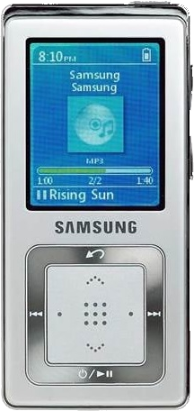

<p align="center">
  
</p>

<h1 align="center">ypz5-manager</h1>

<p align="center">
  A terminal file manager for the <b>Samsung YP-Z5</b> MP3 player<br>
  (and perhaps any other FAT32 disk or image: <em>no guarantees!</em>).
</p>

---

I wanted to recover an old Samsung YP-Z5A player, which is no longer supported, also considering that I mostly work with MacOS nowadays.

Unfortunately, although the YP-Z5 shows up on a Mac as a plain FAT32 disk, Finder litters it
with `.DS_Store` and `._*` files and gives no control over what is written.

Instead, this simple TUI file manager` talks to the filesystem directly. You can browse the files on the player device, copy music
from your Mac, and delete files from the player.

Incidentally, the code that handles the FAT32 filesystem (the `fat32` package) is generic enough to handle other FAT32 devices: however __it has only been tested on the Samsung YP-Z5A__, so use it at your own risk.

## Features

- **Browse** the player's folders, with file details and protected
  system entries clearly marked.
- **Copy** files and folders from the Mac into `/Music` (or any folder you
  pick). Existing files are skipped, never overwritten; folders are merged.
- **Delete** files and folders, with confirmation.
- **Safe by default**: opens read-only unless `--write` is given, refuses
  to write while the disk is mounted, checks free space before copying,
  and never copies `.DS_Store` or `._*` files.
- **Crash-tolerant writes**: an interrupted operation can at worst leak
  free space, never corrupt the filesystem.
- Works on the **real device** or on a **disk image**, whole disk (with
  MBR) or bare partition.

## Installation

Requires [Go](https://go.dev/dl/) 1.27 or later.

```sh
go install github.com/piero/ypz5-manager@latest
```

or build from a checkout:

```sh
go build -o ypz5-manager .
```

## Usage

```sh
ypz5-manager --image PATH  [--write]     # a disk image file
ypz5-manager --device PATH [--write]     # a device node, e.g. /dev/rdisk4
```

Screens are color-coded by the filesystem they operate on:
**blue/cyan** for the YP-Z5, **amber/orange** for the Mac's local files.
Set `NO_COLOR=1` to disable colors.

### Keys

| Screen          | Keys                                                                 |
|-----------------|----------------------------------------------------------------------|
| Browser         | `↑`/`↓` or `k`/`j` move, `PgUp`/`PgDn`/`Home`/`End` scroll, `Enter` open, `Backspace`/`h` up, `q` quit |
| Browser (write) | `n` add files from the Mac, `d` delete (confirm with `y`)            |
| Add files       | `↑`/`↓`, `PgUp`/`PgDn`/`Home`/`End` as above, `Space` select, `Enter` open folder, `Backspace`/`h` up, `t` change destination, `c` copy, `Esc` back |
| Destination     | Browse device folders as above, `s` copy into the current folder, `Esc` cancel |
| Copying         | `Esc` cancels after the current file                                 |

Entries marked `(protected)` (read-only or system, such as `System`,
`DevIcon.fil` and `DevLogo.fil`) cannot be deleted.

### On the real device

> [!WARNING]
> Make a backup image of the player before writing to it
> (see [Backing up the device](#backing-up-the-device)).

1. Connect the player and find its disk (about 2.0 GB, named `YP-Z5`):

   ```sh
   diskutil list
   ```

   The examples below use `disk4`. **Check the number every time**: it
   can change between connections.

2. Unmount it. macOS mounts the player automatically, and `ypz5-manager` refuses
   to write while any part of the disk is mounted:

   ```sh
   diskutil unmountDisk /dev/disk4
   ```

3. Run `ypz5-manager`. Device nodes need `sudo`; the raw node `rdisk` is much
   faster:

   ```sh
   sudo ypz5-manager --device /dev/rdisk4            # read-only
   sudo ypz5-manager --device /dev/rdisk4 --write    # read/write, asks to confirm
   ```

   Every operation is flushed to the device when it finishes. Don't
   unplug the player while a copy or delete is running.

4. Eject, unplug, and let the player rebuild its library from `Music`:

   ```sh
   diskutil eject /dev/disk4
   ```

### Backing up the device

With the player connected and unmounted (steps 1–2 above):

```sh
sudo dd if=/dev/rdisk4 of=yp-z5a-backup.img bs=1m status=progress
sudo chown $USER yp-z5a-backup.img
```

To restore it, which overwrites the whole disk (double-check the number):

```sh
diskutil unmountDisk /dev/disk4
sudo dd if=yp-z5a-backup.img of=/dev/rdisk4 bs=1m status=progress
diskutil eject /dev/disk4
```

## Documentation

- [Technical overview](docs/TECHNICAL.md): architecture, the FAT32
  package, and how writes stay safe.
- [Development guide](docs/DEVELOPMENT.md): working with disk images,
  running the tests, and contributing.

## Disclaimer

This is an unofficial project, not affiliated with or endorsed by
Samsung. Writing to a device's filesystem always carries some risk: keep a
backup.

## License

Released under the [MIT License](LICENSE).
